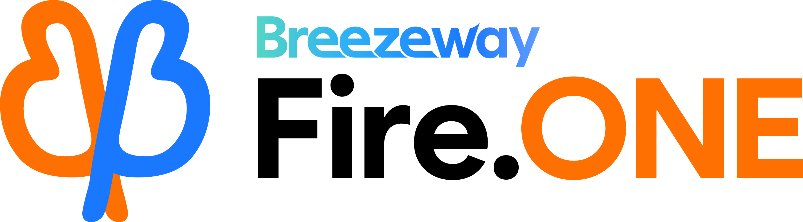

### AI-Driven Security Experiences for the \*.ONE Platform

AI 기반 보안 운영 플랫폼, \*.ONE

[breezeway.one](https://breezeway.one)

 

Breezeway는 AI 기반 보안 운영을 위한 \*.ONE 플랫폼입니다. 
반복적인 보안 운영 업무를 자동화해, 보안팀이 더 가치 있는 판단과 대응에 집중할 수 있도록 돕습니다.

  

<a href="https://breezeway.one/products/fireone">
  <picture>
    <source media="(prefers-color-scheme: dark)" srcset="https://raw.githubusercontent.com/SSNC-RnD/.github/main/profile/fireone_logo_dark.png">
    
  </picture>
</a>

Fire.ONE이 방화벽 운영의 새로운 기준을 제시합니다.

 

Breezeway is the \*.ONE platform for AI-driven security operations, automating repetitive security work so teams can focus on higher-value decisions. 
Learn more at <a href="https://breezeway.one">breezeway.one</a>.

문의 sales@breezeway.one

